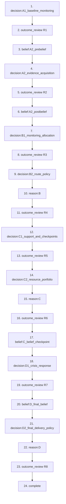

# Current gameplay bible — سناریو ۲ — امواج خاموش

Read-only extraction for HUMAN redesign review. The game was not changed. Source snapshot, extraction scripts, trace CSV and browser observations are the evidence; prior phase docs are historical unless consistent with current source.

## 1 Scenario identity/routing

Released catalog is [0,4,5]. Product display index2 → metadata object id5 → SCENARIO_TREE_IDS[5]='s5_silent_waves_redesign' → S5_SilentWavesRedesign.start='decisionSimulation' → MiniGameHost game='s5_gnss_logistics_simulation' → ScenarioFiveSimulation. Legacy id2 routes to s2_silent_waves and is NOT the current behavior definition. Product Scenario1 is internal id4. After the custom AAR, outer node 'end' remains reachable.

Sources: src/App.tsx RELEASED_SCENARIO_IDS / getScenarioCatalog / SCENARIO_TREE_IDS; src/scenarios/index.ts; src/scenarios/s5_silent_waves_redesign/tree.ts; ScenarioRunner.renderMiniGameNode; MiniGameHost game branch.

## 2 Outer scenario-card metadata

| field | value |
| --- | --- |
| title | امواج خاموش — نسخه بازطراحی |
| introTitle | سناریو ۲ — امواج خاموش |
| summary | چهار کاروان در شبکه لجستیکی در حرکت‌اند. ناهمخوانی‌های PNT/GNSS به‌تدریج ظاهر می‌شوند؛ با منابع محدود باید تصویر اطلاعاتی قابل اتکایی بسازید، تداوم شبکه را حفظ کنید و محموله اولویت‌دار را از دست ندهید. |
| descriptionPreview | چهار کاروان به‌طور هم‌زمان در چهار کریدور عملیاتی حرکت می‌کنند. نشانه‌های موقعیتی و گزارش‌های میدانی ممکن است با هم ناسازگار شوند. شما باید بدون فرض زودهنگام، شواهد را بررسی کنید، منابع محدود را مدیریت کنید و بین حفاظت از محموله اولویت‌دار و تداوم کل شبکه تعادل برقرار کنید. |
| fullDescription | در نقش فرمانده شبکه لجستیکی، چهار کاروان را در شرایط ابهام اطلاعاتی و اختلال احتمالی PNT هدایت می‌کنید. کاروان الف حامل تجهیزات درمانی اضطراری و از نظر مأموریتی اولویت‌دار است؛ این اولویت به معنی آن نیست که از ابتدا بدانید کدام کاروان یا کریدور هدف اختلال است. تصمیم‌های شما زمان عملیاتی و منابع ISR یا پشتیبانی مصرف می‌کنند و می‌توانند گزینه‌های مراحل بعد را محدود کنند. هدف، ساختن تصویر اطلاعاتی قابل دفاع، حفظ تداوم شبکه و مدیریت تحویل کاروان‌ها تحت عدم‌قطعیت است. |

Released title override: «۲ — امواج خاموش». The stored title remains «امواج خاموش — نسخه بازطراحی» for full-catalog context. Collapsed card uses descriptionPreview (or summary) truncated to140 characters plus ellipsis; expanded card uses fullDescription. Badges: ["لجستیک چندمسیره","اختلال","منابع محدود","شواهد متعارض"].

## 3 Outer introduction screen

Title: سناریو ۲ — امواج خاموش

شما فرمانده شبکه لجستیکی هستید. چهار کاروان به‌طور هم‌زمان در چهار کریدور عملیاتی در حرکت‌اند. کاروان الف حامل تجهیزات درمانی اضطراری و از نظر مأموریتی اولویت‌دار است؛ اما این اولویت، شاهدی درباره محل یا هدف اختلال نیست.

در طول مأموریت ممکن است میان داده‌های موقعیت ماهواره‌ای، گزارش‌های میدانی و زمان‌بندی ارتباطی ناهمخوانی ایجاد شود. در ابتدا مشخص نیست این ناهمخوانی ناشی از اختلال هدفمند، عامل غیرخصمانه یا ترکیبی از چند عامل است.

مأموریت شما در چهار فاز و هشت تصمیم پیش می‌رود: ابتدا تصویر مبنا می‌سازید، سپس نشانه‌ها را بررسی می‌کنید، مسیرها و منابع را تحت فشار مدیریت می‌کنید و در پایان درباره تداوم و تحویل شبکه تصمیم می‌گیرید.

هدف شما پیدا کردن یک «پاسخ از پیش معلوم» نیست. باید فقط بر اساس اطلاعاتی که در همان لحظه در اختیار دارید تصمیم بگیرید، شواهد تازه را در نظر بگیرید و توان واکنش برای مراحل بعد را حفظ کنید.

PNT یعنی «موقعیت‌یابی، ناوبری و زمان‌بندی»؛ یعنی اطلاعاتی که برای دانستن موقعیت، مسیر حرکت و زمان دقیق به کار می‌رود.
GNSS خانواده سامانه‌های ناوبری ماهواره‌ای مانند GPS است و یکی از منابع مهم PNT محسوب می‌شود.
ISR در این سناریو ظرفیت شناسایی، مراقبت و جمع‌آوری اطلاعات است.

The «شروع» button dismisses the outer modal without creating the runtime.

## 4 Internal mission briefing

Heading: سناریو ۲ — امواج خاموش

Main title: فرماندهی لجستیک در اختلال PNT

وضعیت: چهار کاروان در شبکه در حرکت‌اند. کاروان الف حامل تجهیزات درمانی اضطراری و اولویت‌دار است، اما هنوز هیچ اطلاعات معتبری نشان نمی‌دهد که کدام کریدور منشأ اصلی اختلال است.

آنچه می‌دانید:
- چهار کریدور هم‌زمان فعال‌اند و هر تصمیم می‌تواند روی زمان و منابع اثر بگذارد.
- ISR و ذخیره پشتیبانی محدودند.
- گزارش‌های موقعیتی، میدانی و ارتباطی ممکن است با هم ناسازگار باشند.
- کاروان الف اولویت مأموریتی دارد؛ اولویت مأموریتی به معنی هدف‌بودن آن نیست.

آنچه هنوز نمی‌دانید:
- کدام کریدور واقعاً بیشترین اختلال را تجربه می‌کند.
- آیا الگوی مشاهده‌شده هدفمند است یا توضیح غیرخصمانه دارد.
- طرف مقابل، در صورت وجود، چگونه به تصمیم‌های آشکار شما واکنش نشان می‌دهد.

قاعده تصمیم: در این تمرین پاسخ صحیح از پیش نمایش‌داده‌شده وجود ندارد. فقط بر اساس اطلاعاتی که تا همان لحظه دیده‌اید تصمیم بگیرید.

این زمان، ساعت عملیاتی داخل شبیه‌سازی است و با مدت واقعی اجرای بازی متفاوت است.

Button: آغاز مأموریت. Assignment uses profileId, epochStartedAt, FNV hashes and the canonical world catalog. Hidden world/seed are not sent to live player props.

## 5 Glossary / terminology

| term | whereFirstSeen | definitionCurrentlyProvided | definitionText | laterUses | possibleTerminologyInconsistency |
| --- | --- | --- | --- | --- | --- |
| PNT | outer card/metadata, before intro definitions | true | موقعیت‌یابی، ناوبری و زمان‌بندی؛ اطلاعاتی که برای تعیین موقعیت، جهت/مسیر حرکت و زمان دقیق استفاده می‌شود. | intro / briefing / action cards / evidence / live header / AAR | Card introduces acronym before later definition; exact intro definitions and full live glossary wording differ in length. |
| GNSS | outer card/metadata, before intro definitions | true | سامانه‌های ناوبری ماهواره‌ای جهانی، مانند GPS؛ یکی از منابع اصلی داده PNT. | intro / briefing / action cards / evidence / live header / AAR | Card introduces acronym before later definition; exact intro definitions and full live glossary wording differ in length. |
| ISR | outer card/metadata, before intro definitions | true | ظرفیت شناسایی، مراقبت و جمع‌آوری اطلاعات برای ساختن تصویر عملیاتی. | intro / briefing / action cards / evidence / live header / AAR | Card introduces acronym before later definition; exact intro definitions and full live glossary wording differ in length. |
| fallback navigation / ناوبری پشتیبان | B2 cross-check action / C1 fallback action | false | No separate formal definition; action title/copy describes activation. | NAV map badge; AAR raw fallback | Persian action title, NAV badge and raw fallback label name the same flag. |
| attribution / operational attribution / انتساب عملیاتی | evidence limitations, then AAR | false | No player-facing rule explaining two distinct supporting source types plus a moderate/strong item. | AAR resolved/unresolved labels; end-state label منشأ اختلال حل‌نشده | Operational corroboration is not explicitly defined as distinct from knowing the true primary corridor. |
| continuity / تداوم شبکه | scenario card and intro | true | تداوم عملیاتی شبکه، سهم کاروان‌هایی است که با یکپارچگی حداقل ۶۰ و تا مهلت عملیاتی خود به مقصد رسیده‌اند. | AAR continuity percent/end-state | Numeric definition appears only after completion; delivery status uses integrity55 while continuity uses60+deadline. |
| integrity / یکپارچگی | live under-map card | false | No standalone definition or live 55/60 threshold explanation. | outcome before/after; AAR alpha/secondary | Navigation-integrity section reports PNT exposure as well as convoy damage/counts. |
| ETA / projected arrival | under-map card | true | زمان برآوردی رسیدن (outcome label; no acronym expansion) | AAR ورود / مهلت | English ETA not in glossary; current ETA is absolute T+ baseline+delay, not remaining travel time. |
| deadline / D / مهلت | under-map D T+ card | false | No glossary entry; outcome labels مهلت تحویل and فاصله تا مهلت. | AAR horizon/delivery/continuity | Deadline and 360-minute horizon are different constraints. |
| evidence / شاهد / شواهد | intro | true | این موارد بخشی از تصویر عملیاتی شما هستند. بازکردن جزئیات یک شاهد می‌تواند کیفیت یا محدودیت همان منبع را نشان دهد. | summaries, map counts, read-only belief/reason, AAR provenance | Summary viewing and explicit detail-open are different telemetry behaviors; empty-open count does not make completeness incomplete. |
| targeted interference / اخلال هدفمند | outer intro | true | Direction labels describe compatibility, not certainty; full definition not separate. | belief estimates / evidence / final AAR | Every hidden world contains an Actor; prior player narrative remains uncertain; R7 title unconditionally says active threat. |
| corridor / کریدور | card/intro | true | Four corridor/convoy cards and map identify east/south/northwest/west. | targets, belief cards, evidence observed location | Mission-priority alpha expressly is not targeting evidence. |
| Actor / طرف مقابل / عامل مقابل | briefing unknowns (conditional) | true | طرف مقابل، در صورت وجود، چگونه به تصمیم‌های آشکار شما واکنش نشان می‌دهد. | reason label; AAR Actor delay and profile/posture | English Actor appears in AAR delay table; existence remains conditional in briefing but true in every model world. |
| OSI / Orientation | AAR | true | منفی‌تر = عملیاتی‌تر نسبت به گزینه‌های همان موقعیت؛ مثبت‌تر = راهبردی‌تر. این محور کیفیت تصمیم نیست. | overall and phase scores | OSI acronym is not expanded; relative centered orientation is separate from absolute operational/strategic loadings. |
| IQR / SD / HHI | AAR | false | No displayed definition of interquartile range, population standard deviation or attention concentration. | timing summary/network balance | These abbreviations are absent from the 3-term glossary. |
| جست‌وجوی اطلاعات | AAR | false | Label and generic proxy disclaimer only; no construct-specific formula displayed. | cognitive.constructs.informationSeeking | Construct label alone is not a psychometric definition; no global cognitive score exists. |
| تفکر مرحله دوم | AAR | false | Label and generic proxy disclaimer only; no construct-specific formula displayed. | cognitive.constructs.secondOrderThinking | Construct label alone is not a psychometric definition; no global cognitive score exists. |
| مدل‌سازی طرف مقابل | AAR | false | Label and generic proxy disclaimer only; no construct-specific formula displayed. | cognitive.constructs.adversaryModeling | Construct label alone is not a psychometric definition; no global cognitive score exists. |
| حساسیت به تشدید | AAR | false | Label and generic proxy disclaimer only; no construct-specific formula displayed. | cognitive.constructs.escalationSensitivity | Construct label alone is not a psychometric definition; no global cognitive score exists. |
| نظم اطلاعاتی | AAR | true | در نسخه فعلی این سناریو اندازه‌گیری نمی‌شود. | cognitive.constructs.informationDiscipline | Construct label alone is not a psychometric definition; no global cognitive score exists. |
| به‌روزرسانی متناسب با شواهد | AAR | false | Label and generic proxy disclaimer only; no construct-specific formula displayed. | cognitive.constructs.evidenceResponsiveUpdating | Construct label alone is not a psychometric definition; no global cognitive score exists. |
| نگهداشت و تخصیص منابع | AAR | false | Label and generic proxy disclaimer only; no construct-specific formula displayed. | cognitive.constructs.resourceStewardship | Construct label alone is not a psychometric definition; no global cognitive score exists. |
| برنامه‌ریزی و آینده‌نگری | AAR | false | Label and generic proxy disclaimer only; no construct-specific formula displayed. | cognitive.constructs.planningForesight | Construct label alone is not a psychometric definition; no global cognitive score exists. |
| یکپارچه‌سازی چندمعیاره | AAR | false | Label and generic proxy disclaimer only; no construct-specific formula displayed. | cognitive.constructs.multiDomainIntegration | Construct label alone is not a psychometric definition; no global cognitive score exists. |
| وضعیت نسبی پذیرش ریسک | AAR | true | منفی‌تر یا مثبت‌تر فقط جایگاه نسبی انتخاب در برابر گزینه‌های همان موقعیت است و ارزش‌گذاری خوب/بد ندارد. | cognitive.constructs.riskPosture | Construct label alone is not a psychometric definition; no global cognitive score exists. |
| انسجام تصمیم | AAR | false | Label and generic proxy disclaimer only; no construct-specific formula displayed. | cognitive.constructs.decisionCoherence | Construct label alone is not a psychometric definition; no global cognitive score exists. |

Full occurrence-level text is in scenario5-player-copy-catalog.csv. Terms with no current definition are recorded as such; no replacement terminology is proposed.

## 6 Complete runtime stage order

17 distinct IDs, 24 ordered runtime occurrences: 8 decisions + 8 outcome reviews + 4 beliefs + 3 reason gates + completion. The same outcome_review ID has round-dependent context. Outer card/intro/briefing and outer end are not runtime IDs. Evidence/glossary are local views, not new stages.

| sequence | runtimeStageId | phase | round | playerTitle | nextStage | notes |
| --- | --- | --- | --- | --- | --- | --- |
| 1 | decision:A1_baseline_monitoring | A | 1 | پیش از تشدید هرگونه ناهنجاری، چه تصویری از وضعیت شبکه می‌سازید؟ | outcome_review | Confirm immediately commits mission; then outcome review. No score displayed. |
| 2 | outcome_review | A | 1 | پیامد قابل مشاهده — راند 1 | belief:A2_prebelief | All mission effects already applied. Continue only changes runtime chronology/stage. Final R8 pending evidence may arrive after final belief. |
| 3 | belief:A2_prebelief | A | 1 | برداشت اولیه — پیش از بررسی تکمیلی | decision:A2_evidence_acquisition | No mission time/resource mutation. Inputs initially null and corridor unselected. Header round refers to last committed decision; hidden world/Actor/provenance/scores remain unavailable. |
| 4 | decision:A2_evidence_acquisition | A | 2 | نشانه‌های اولیه با چه روش اطلاعاتی باید بررسی شوند؟ | outcome_review | Confirm immediately commits mission; then outcome review. No score displayed. |
| 5 | outcome_review | A | 2 | پیامد قابل مشاهده — راند 2 | belief:A2_postbelief | All mission effects already applied. Continue only changes runtime chronology/stage. Final R8 pending evidence may arrive after final belief. |
| 6 | belief:A2_postbelief | A | 2 | بازنگری برداشت — پس از شواهد جدید | decision:B1_monitoring_allocation | No mission time/resource mutation. Inputs initially null and corridor unselected. Header round refers to last committed decision; hidden world/Actor/provenance/scores remain unavailable. |
| 7 | decision:B1_monitoring_allocation | B | 3 | ظرفیت توجه و پایش بعدی را کجا متمرکز می‌کنید؟ | outcome_review | Confirm immediately commits mission; then outcome review. No score displayed. |
| 8 | outcome_review | B | 3 | پیامد قابل مشاهده — راند 3 | decision:B2_route_policy | All mission effects already applied. Continue only changes runtime chronology/stage. Final R8 pending evidence may arrive after final belief. |
| 9 | decision:B2_route_policy | B | 4 | در شرایطی که هنوز علت اختلال قطعی نیست، سیاست حرکت کریدور انتخابی چیست؟ | reason:B | Confirm defers mission mutation until reason; then commit consumes resources, adds base20+duration, effects/Actor/evidence/status. R8 finalizes at T+360. |
| 10 | reason:B | B | 4 | دلیل اصلی تصمیم | outcome_review | Map/resources remain PRE-decision until reason submitted; confirmed action/target shown as read-only context. |
| 11 | outcome_review | B | 4 | پیامد قابل مشاهده — راند 4 | decision:C1_support_and_checkpoints | All mission effects already applied. Continue only changes runtime chronology/stage. Final R8 pending evidence may arrive after final belief. |
| 12 | decision:C1_support_and_checkpoints | C | 5 | برای افزایش تاب‌آوری شبکه کدام اقدام پشتیبانی را فعال می‌کنید؟ | outcome_review | Confirm immediately commits mission; then outcome review. No score displayed. |
| 13 | outcome_review | C | 5 | پیامد قابل مشاهده — راند 5 | decision:C2_resource_portfolio | All mission effects already applied. Continue only changes runtime chronology/stage. Final R8 pending evidence may arrive after final belief. |
| 14 | decision:C2_resource_portfolio | C | 6 | ذخایر باقی‌مانده را برای ادامه مأموریت چگونه توزیع می‌کنید؟ | reason:C | Confirm defers mission mutation until reason; then commit consumes resources, adds base20+duration, effects/Actor/evidence/status. R8 finalizes at T+360. |
| 15 | reason:C | C | 6 | دلیل اصلی تصمیم | outcome_review | Map/resources remain PRE-decision until reason submitted; confirmed action/target shown as read-only context. |
| 16 | outcome_review | C | 6 | پیامد قابل مشاهده — راند 6 | belief:C_belief_checkpoint | All mission effects already applied. Continue only changes runtime chronology/stage. Final R8 pending evidence may arrive after final belief. |
| 17 | belief:C_belief_checkpoint | C | 6 | به‌روزرسانی برداشت — پس از تغییر وضعیت | decision:D1_crisis_response | No mission time/resource mutation. Inputs initially null and corridor unselected. Header round refers to last committed decision; hidden world/Actor/provenance/scores remain unavailable. |
| 18 | decision:D1_crisis_response | D | 7 | با فعال‌شدن فشار عملیاتی، پاسخ فوری شبکه چه باشد؟ | outcome_review | Confirm immediately commits mission; then outcome review. No score displayed. |
| 19 | outcome_review | D | 7 | پیامد قابل مشاهده — راند 7 | belief:D_final_belief | All mission effects already applied. Continue only changes runtime chronology/stage. Final R8 pending evidence may arrive after final belief. |
| 20 | belief:D_final_belief | D | 7 | برآورد نهایی — پیش از سیاست تحویل | decision:D2_final_delivery_policy | No mission time/resource mutation. Inputs initially null and corridor unselected. Header round refers to last committed decision; hidden world/Actor/provenance/scores remain unavailable. |
| 21 | decision:D2_final_delivery_policy | D | 8 | برای پایان مأموریت، کدام سیاست تحویل و تداوم را انتخاب می‌کنید؟ | reason:D | Confirm defers mission mutation until reason; then commit consumes resources, adds base20+duration, effects/Actor/evidence/status. R8 finalizes at T+360. |
| 22 | reason:D | D | 8 | دلیل اصلی تصمیم | outcome_review | Map/resources remain PRE-decision until reason submitted; confirmed action/target shown as read-only context. |
| 23 | outcome_review | D | 8 | پیامد قابل مشاهده — راند 8 | complete | All mission effects already applied. Continue only changes runtime chronology/stage. Final R8 pending evidence may arrive after final belief. |
| 24 | complete | D | 8 | امواج خاموش — تحلیل اجرای مأموریت | outer end after AAR finish | Hidden truth and domain/cognitive results may now be shown; completion UI hides host stop control. |

Detailed controls, information, telemetry and transitions are in scenario5-flow-nodes.csv; source tables DECISION_STAGE_METADATA / BELIEF_STAGE_METADATA / RUNTIME_STAGE_SEQUENCE are authoritative.

## 7 Screen-by-screen player journey

See scenario5-screen-journey-current.md. The 39 browser captures include all 28 required screens, local glossary, collapsed/expanded evidence, entered belief, seven additional AAR sections and the actual outer end screen. Map/header stay mounted during outcomes but are blurred/occluded by the blocking outcome dialog.

## 8 All 8 decision windows

| round | phase | actionId | title | description | knownEffect | target | isr | support | duration |
| --- | --- | --- | --- | --- | --- | --- | --- | --- | --- |
| 1 | A | a1_network_baseline | پایش مبنای سراسری | یک تصویر پایه از الگوهای PNT در کل شبکه تهیه کنید. | پوشش اطلاعاتی گسترده‌تر؛ مصرف ISR بیشتر. | none | 16 | 0 | 10 |
| 1 | A | a1_priority_focus | تمرکز اولیه بر کاروان پزشکی | پایش اولیه را روی کریدور شرقی و محموله اولویت‌دار متمرکز کنید. | تمرکز بالا روی کاروان الف؛ پوشش کمتر برای سایر کریدورها. | fixed_alpha | 10 | 0 | 8 |
| 1 | A | a1_rotating_watch | پایش چرخشی شبکه | گزارش‌های میدانی و رادیویی را به‌صورت چرخشی میان کریدورها مقایسه کنید. | پوشش چندمحوره با شدت متوسط. | none | 12 | 0 | 10 |
| 1 | A | a1_preserve_reserve | حفظ ذخیره پایش | پایش روتین را ادامه دهید و ظرفیت ISR را برای مراحل بعد نگه دارید. | مصرف فوری ناچیز؛ اطلاعات جدید محدودتر. | none | 0 | 0 | 5 |
| 2 | A | a2_focused_pnt | تحلیل هدفمند PNT | ناهمخوانی‌های موقعیت را روی یک کریدور منتخب با دقت بیشتری بررسی کنید. | تحلیل عمیق یک محور؛ نیازمند انتخاب کریدور. | required | 14 | 0 | 12 |
| 2 | A | a2_broad_sweep | پویش سراسری چندکریدوری | الگوهای PNT کل شبکه را هم‌زمان برای یافتن ناهمخوانی‌های متقاطع بررسی کنید. | پوشش وسیع؛ مصرف بالاتر ISR. | none | 22 | 0 | 18 |
| 2 | A | a2_field_radio | تطبیق گزارش میدانی و رادیویی | گزارش کاروان و داده ارتباطی یک کریدور را با تصویر موقعیت مقایسه کنید. | منبع مستقل از PNT؛ نیازمند انتخاب کریدور. | required | 0 | 4 | 15 |
| 2 | A | a2_ground_liaison | اعزام رابط زمینی | برای بررسی محلی یک کریدور، تیم رابط زمینی اعزام کنید. | شاهد زمینی با تأخیر زمانی؛ مصرف ذخیره پشتیبانی. | required | 0 | 12 | 20 |
| 3 | B | b1_suspect_focus | تمرکز روی کریدور مشکوک | پایش بعدی را روی کریدوری که در حال حاضر مشکوک‌تر می‌دانید متمرکز کنید. | وضوح بیشتر در یک محور؛ کاهش پوشش نسبی شبکه. | required | 12 | 0 | 10 |
| 3 | B | b1_priority_cargo | پایش ویژه محموله پزشکی | ظرفیت پایش را روی کاروان الف و استمرار حرکت آن متمرکز کنید. | اولویت به محموله حیاتی؛ پوشش کمتر سایر محورها. | fixed_alpha | 10 | 0 | 8 |
| 3 | B | b1_split_attention | تقسیم توجه بین کریدورها | ظرفیت ISR را میان چند محور تقسیم کنید تا یک تصویر مقایسه‌ای حفظ شود. | پوشش متوازن‌تر؛ تمرکز کمتر روی هر محور. | none | 16 | 0 | 12 |
| 3 | B | b1_pulse_network | پایش پالسی کل شبکه | به‌جای رصد پیوسته، نمونه‌های کوتاه و دوره‌ای از کل شبکه بگیرید. | حفظ بخشی از ذخیره همراه با دید شبکه‌ای. | none | 8 | 0 | 8 |
| 4 | B | b2_continue_crosscheck | ادامه مسیر با تطبیق و ناوبری پشتیبان | حرکت کریدور منتخب را ادامه دهید و موقعیت را با روش پشتیبان کنترل کنید. | فعال‌سازی ناوبری پشتیبان؛ تأخیر مستقیم محدود. | required | 4 | 8 | 8 |
| 4 | B | b2_reroute | تغییر مسیر اضطراری | کریدور منتخب را از مسیر فعلی خارج و روی مسیر جایگزین هدایت کنید. | کاهش وابستگی به مسیر فعلی؛ افزایش محسوس تأخیر. | required | 0 | 14 | 20 |
| 4 | B | b2_staged_checkpoints | حرکت مرحله‌ای با نقاط کنترل | حرکت را به چند قطعه کنترل‌شده با نقاط بررسی موقعیت تقسیم کنید. | کنترل بیشتر مسیر؛ افزایش تأخیر عملیاتی. | required | 0 | 10 | 16 |
| 4 | B | b2_hold_verify | توقف موقت برای راستی‌آزمایی | کریدور منتخب را موقتاً نگه دارید تا بررسی هدفمند تکمیل شود. | اطلاعات بیشتر در برابر بیشترین تأخیر مستقیم این راند. | required | 6 | 0 | 25 |
| 5 | C | c1_fallback_nav | فعال‌سازی ناوبری پشتیبان | برای کریدور منتخب، اتکا به GNSS را با روش ناوبری جایگزین کاهش دهید. | تاب‌آوری ناوبری بیشتر؛ مصرف ذخیره پشتیبانی. | required | 0 | 14 | 12 |
| 5 | C | c1_ground_recon | شناسایی و پشتیبانی زمینی | تیم زمینی را برای بررسی مسیر و پشتیبانی محلی اعزام کنید. | پشتیبانی زمینی پایدارتر؛ شاهد زمینی با تأخیر. | required | 0 | 18 | 20 |
| 5 | C | c1_checkpoint_spacing | نقاط کنترل و فاصله‌گذاری حرکت | عبور کریدور منتخب را با فاصله‌گذاری و نقاط کنترل سازمان‌دهی کنید. | سخت‌سازی مسیر در برابر اختلال؛ تأخیر متوسط. | required | 0 | 10 | 15 |
| 5 | C | c1_preserve_mobile_reserve | حفظ ذخیره متحرک | از مصرف پشتیبانی جدید خودداری کنید و ذخیره را برای بحران بعدی نگه دارید. | حفظ حداکثری ذخیره؛ بدون پوشش جدید فوری. | none | 0 | 0 | 5 |
| 6 | C | c2_isr_heavy | سبد اطلاعات‌محور | بخش بیشتری از منابع باقی‌مانده را صرف پایش و شناخت شبکه کنید. | اطلاعات شبکه‌ای بیشتر؛ پشتیبانی فیزیکی محدودتر. | none | 18 | 4 | 10 |
| 6 | C | c2_mobility_heavy | سبد تاب‌آوری حرکتی | منابع را عمدتاً به تحرک، fallback و پشتیبانی شبکه اختصاص دهید. | پوشش حفاظتی قوی‌تر برای کل شبکه تا پایان راند ۷. | none | 4 | 18 | 10 |
| 6 | C | c2_balanced | سبد متوازن شبکه | ISR و پشتیبانی را بدون تمرکز شدید روی یک حوزه تقسیم کنید. | پوشش حفاظتی متوسط برای کل شبکه تا پایان راند ۷. | none | 10 | 10 | 10 |
| 6 | C | c2_priority_surge | تمرکز منابع بر کاروان الف | منابع مرحله را برای حفاظت و پایش محموله پزشکی متمرکز کنید. | حفاظت قوی‌تر کاروان الف؛ کاهش نسبی پوشش سایر کریدورها. | fixed_alpha | 12 | 20 | 10 |
| 7 | D | d1_emergency_reroute | تغییر مسیر فوری | کریدور منتخب را برای خروج سریع از وضعیت فعلی به مسیر جایگزین منتقل کنید. | سخت‌سازی مسیر در برابر فشار؛ تأخیر قابل توجه. | required | 0 | 16 | 20 |
| 7 | D | d1_ground_containment | مهار زمینی منبع اختلال | تیم زمینی را برای شناسایی و مهار محلی منبع اختلال احتمالی وارد عمل کنید. | اقدام آشکار و پرمنبع؛ شاهد زمینی با تأخیر. | required | 0 | 22 | 25 |
| 7 | D | d1_deception_routing | مسیرگذاری فریبنده | الگوی حرکت کریدور منتخب را طوری تغییر دهید که برداشت طرف ناظر از مسیر دشوارتر شود. | تغییر مسیر قابل مشاهده با تأخیر متوسط. | required | 0 | 12 | 15 |
| 7 | D | d1_escorted_continuation | ادامه حرکت با اسکورت | حرکت کریدور منتخب را با پشتیبانی نزدیک تا پایان راند ادامه دهید. | حفاظت مستقیم موقت؛ مصرف قابل توجه پشتیبانی. | required | 0 | 18 | 12 |
| 7 | D | d1_hold_confirm | توقف و تأیید نهایی | کریدور منتخب را موقتاً متوقف کنید و پیش از ادامه، تحلیل هدفمند دیگری انجام دهید. | اطمینان اطلاعاتی بیشتر در برابر تأخیر عملیاتی. | required | 8 | 0 | 20 |
| 8 | D | d2_critical_delivery_surge | شتاب تحویل محموله حیاتی | ظرفیت پشتیبانی نهایی را برای رساندن کاروان الف به مقصد متمرکز کنید. | کاهش تأخیر کاروان الف و اسکورت نهایی؛ تمرکز بالا روی محموله اولویت‌دار. | fixed_alpha | 0 | 14 | 12 |
| 8 | D | d2_network_balanced_finish | پایان متوازن شبکه | منابع نهایی را برای حفظ حرکت و حفاظت همه کریدورهای فعال تقسیم کنید. | کاهش محدود تأخیر کل شبکه و حفاظت موقت همگانی. | none | 0 | 10 | 15 |
| 8 | D | d2_resilient_handoff | تحویل تاب‌آور با ناوبری پشتیبان | تحویل نهایی کاروان الف را با fallback ناوبری و handoff کنترل‌شده انجام دهید. | تاب‌آوری بیشتر تحویل در برابر مقداری تأخیر اضافی. | fixed_alpha | 0 | 12 | 18 |
| 8 | D | d2_continuity_first_finish | پایان با اولویت تداوم شبکه | در پایان، سرعت نسبی کاروان‌های دیگر را بر تمرکز کامل روی الف مقدم کنید. | کاهش تأخیر کاروان‌های ثانویه در برابر تأخیر بیشتر کاروان الف. | none | 0 | 8 | 15 |

There are exactly33 options. Costs/durations are read directly by ActionCard from the frozen catalog. Available families are filtered by current round, remaining budgets and active target status. Required targets must be canonical/not delivered; compromised remains legal. Fixed-alpha cannot be retargeted. No action is auto-selected. Full action profiles/effects/source hooks are in scenario5-action-catalog-current.csv.

### Branch structure / path count

| round | actionFamilies | none | fixedAlpha | required | maxActionTargetPairs | resourceDependentRule | statusDependentRule |
| --- | --- | --- | --- | --- | --- | --- | --- |
| 1 | 4 | 3 | 1 | 0 | 4 | both budgets sufficient | delivered excluded as target; compromised legal; fixed-alpha requires active alpha |
| 2 | 4 | 1 | 0 | 3 | 13 | both budgets sufficient | delivered excluded as target; compromised legal; fixed-alpha requires active alpha |
| 3 | 4 | 2 | 1 | 1 | 7 | both budgets sufficient | delivered excluded as target; compromised legal; fixed-alpha requires active alpha |
| 4 | 4 | 0 | 0 | 4 | 16 | both budgets sufficient | delivered excluded as target; compromised legal; fixed-alpha requires active alpha |
| 5 | 4 | 1 | 0 | 3 | 13 | both budgets sufficient | delivered excluded as target; compromised legal; fixed-alpha requires active alpha |
| 6 | 4 | 3 | 1 | 0 | 4 | both budgets sufficient | delivered excluded as target; compromised legal; fixed-alpha requires active alpha |
| 7 | 5 | 0 | 0 | 5 | 20 | both budgets sufficient | delivered excluded as target; compromised legal; fixed-alpha requires active alpha |
| 8 | 4 | 2 | 2 | 0 | 4 | both budgets sufficient | delivered excluded as target; compromised legal; fixed-alpha requires active alpha |

Naive action+target maximum ignoring state constraints = 24227840; action-family-only maximum = 81920. Exact resource-only upper bound from memoized (round,ISR,support) DP with all four targets assumed active = 24227840; 2244 memo states. This equals the naive count: the cost filter alone prunes NO normal-start sequence under the current catalog. Maximum cumulative costs by round:

| round | maxCumulativeIsr | maxCumulativeSupport |
| --- | --- | --- |
| 1 | 16 | 0 |
| 2 | 38 | 12 |
| 3 | 54 | 12 |
| 4 | 60 | 26 |
| 5 | 60 | 44 |
| 6 | 78 | 64 |
| 7 | 86 | 86 |
| 8 | 86 | 100 |

This is NOT an exact reachable world/seed count; delivered targets still change reachability. Reasons multiply the input surface by7^3; four belief checkpoints each allow 4*101^3 discrete UI responses. Continuous decision times/evidence open histories further prevent a single finite count of all behavioral paths. Mission reachability depends on actor state, delivered targets, convoy flags/delay, pending evidence, clock and resources. Current structuredReachability uses beam limit2500 for witnesses, not exact enumeration. This audit does not enumerate up to24 million full mission histories per world or claim a global exact count. No probabilities are assigned.

## 9 All belief checkpoints

| id | title | instruction | next |
| --- | --- | --- | --- |
| belief:A2_prebelief | برداشت اولیه — پیش از بررسی تکمیلی | این ثبت، نقطه مبنای برداشت شماست. هنوز اطلاعات کامل ندارید و پایین‌بودن اطمینان کاملاً طبیعی است. فقط بر اساس شواهدی که تا این لحظه دیده‌اید پاسخ دهید؛ در مرحله بعد می‌توانید بررسی اطلاعاتی بیشتری انجام دهید. | decision:A2_evidence_acquisition |
| belief:A2_postbelief | بازنگری برداشت — پس از شواهد جدید | بررسی اطلاعاتی مرحله قبل ممکن است تصویر شما را تغییر داده باشد یا تغییر نداده باشد. با توجه به شواهد فعلی، برداشت خود را دوباره ثبت کنید. | decision:B1_monitoring_allocation |
| belief:C_belief_checkpoint | به‌روزرسانی برداشت — پس از تغییر وضعیت | با توجه به شواهد و روند مأموریت تا این لحظه، برداشت فعلی خود را ثبت کنید. | decision:D1_crisis_response |
| belief:D_final_belief | برآورد نهایی — پیش از سیاست تحویل | پیش از تصمیم نهایی تحویل، آخرین برداشت خود از محل و ماهیت اختلال را ثبت کنید. | decision:D2_final_delivery_policy |

Four native corridor radio cards and three range inputs min0/max100/step1. All semantic values initially null; corridor has no default. Native midpoint50 is only a display placeholder, marked ثبت نشده with no filled bar/visible thumb. Submit requires all four responses. Explicit pointer midpoint can register50. Keyboard first arrows register49/51; Home0/End100. The runtime accepts finite0..100 fields and records unchanged field names plus checkpoint evidence IDs. No mission state change, correctness feedback or slider telemetry. Prebelief shows all current summaries, postbelief separates evidence since start of A2 acquisition from older IDs. If no evidence, text remains explicit and no synthetic item is generated.

## 10 All reason gates

R4→reason:B, R6→reason:C, R8→reason:D. Confirmed action/target is pending and mission state is unchanged until reason submission. All seven reasons: {"reason_mission_speed":"حفظ سرعت و پیشروی مأموریت","reason_reduce_exposure":"کاهش مواجهه با اختلال یا تهدید","reason_preserve_resources":"حفظ منابع برای مراحل بعد","reason_network_continuity":"حفظ تداوم کل شبکه لجستیکی","reason_information_confidence":"افزایش اطمینان اطلاعاتی پیش از ادامه","reason_limit_actor_reaction":"محدودکردن امکان واکنش شدیدتر طرف مقابل","reason_preserve_reversibility":"حفظ گزینه‌های برگشت‌پذیر برای تصمیم‌های بعد"}. Read-only information picture precedes reason radios. Reason telemetry includes phaseId, reasonId, recordedAtMs, capturedBeforeOutcome=true. Existing phase alignment/coherence uses it later, not live correctness.

## 11 All observable-outcome screens

Every decision commits before its outcome. Blocks in exact order: اقدام اجراشده; اطلاعات تازه; تغییرات قابل مشاهده. The action/target, clock before→after, spent ISR/support, actual new evidence summaries and changed convoy values are shown. Status/integrity rows are conditional on change; delay and projected arrival before→after, deadline and margin are always present for changed convoys. margin=deadline-projectedArrivalAfter; nonnegative uses فاصله تا مهلت, negative عبور از مهلت. Outcome_continue advances runtime stage only; R8 continuation enables AAR truth reveal. All specific changes are in 1024 outcome rows of path traces.

## 12 Evidence flow

Seven supported source labels/enums, four actually emitted generator source types.

| sourceType | persianLabel | directionValues | strengthValues | releaseMechanism | notes |
| --- | --- | --- | --- | --- | --- |
| pnt_telemetry | تله‌متری PNT/GNSS | supports_targeted / ambiguous / supports_nonhostile | weak / moderate | focused_pnt_analysis / broad_pnt_sweep | Emitted in current 128-run corpus; full supported semantics determined by materializeEvidence and included source excerpts. Corpus observed values are not an exhaustive branch proof. |
| field_report | گزارش میدانی کاروان | supports_targeted / ambiguous / supports_nonhostile | weak | field_radio_corroboration | Emitted in current 128-run corpus; full supported semantics determined by materializeEvidence and included source excerpts. Corpus observed values are not an exhaustive branch proof. |
| radio_timing | تحلیل زمان‌بندی رادیویی | supports_targeted | weak | field_radio_corroboration | Emitted in current 128-run corpus; full supported semantics determined by materializeEvidence and included source excerpts. Corpus observed values are not an exhaustive branch proof. |
| satellite_isr | پایش ماهواره‌ای ISR | supports_targeted / ambiguous / supports_nonhostile (type contract only) | weak / moderate / strong (type contract only) |  | Declared source enum and Persian mapping, but NO generation branch in the current evidence model. Not an active arrival in these paths. |
| ground_recon | بررسی زمینی | supports_targeted / ambiguous / supports_nonhostile | weak / moderate / strong | ground_liaison | Emitted in current 128-run corpus; full supported semantics determined by materializeEvidence and included source excerpts. Corpus observed values are not an exhaustive branch proof. |
| route_pattern | تحلیل الگوی مسیر | supports_targeted / ambiguous / supports_nonhostile (type contract only) | weak / moderate / strong (type contract only) |  | Declared source enum and Persian mapping, but NO generation branch in the current evidence model. Not an active arrival in these paths. |
| cross_source_analysis | تحلیل چندمنبعی | supports_targeted / ambiguous / supports_nonhostile (type contract only) | weak / moderate / strong (type contract only) |  | Declared source enum and Persian mapping, but NO generation branch in the current evidence model. Not an active arrival in these paths. |

Direction mapping: {"supports_targeted":"با فرضیه اخلال هدفمند سازگار","ambiguous":"مبهم / چندتفسیره","supports_nonhostile":"بیشتر با علت غیرخصمانه سازگار"}. Strength mapping: {"weak":"ضعیف","moderate":"متوسط","strong":"قوی"}.

| round | evidenceBeforeRange | evidenceAfterRange | freshRange | ownRequests | otherArrivalCondition | whereShown | extraAction |
| --- | --- | --- | --- | --- | --- | --- | --- |
| 1 | 0..0 | 0..6 | 0..6 | a1_network_baseline: {"requestKind":"broad_pnt_sweep","timing":"immediate","target":"none"}; a1_priority_focus: {"requestKind":"focused_pnt_analysis","timing":"immediate","target":"effective_target"}; a1_rotating_watch: {"requestKind":"field_radio_corroboration","timing":"immediate","target":"none"} | previous pending request due at exact next structural tick | actual new summaries in outcome; total evidence badges immediately on map; next decision local evidence view; next belief/reason read-only summary | read-only summaries automatic; detailed quality/limitation require explicit decision-stage evidence view and open; no open on belief/outcome/reason |
| 2 | 0..6 | 0..8 | 0..4 | a2_focused_pnt: {"requestKind":"focused_pnt_analysis","timing":"immediate","target":"effective_target"}; a2_broad_sweep: {"requestKind":"broad_pnt_sweep","timing":"immediate","target":"none"}; a2_field_radio: {"requestKind":"field_radio_corroboration","timing":"immediate","target":"effective_target"}; a2_ground_liaison: {"requestKind":"ground_liaison","timing":"pending","target":"effective_target"} | previous pending request due at exact next structural tick | actual new summaries in outcome; total evidence badges immediately on map; next decision local evidence view; next belief/reason read-only summary | read-only summaries automatic; detailed quality/limitation require explicit decision-stage evidence view and open; no open on belief/outcome/reason |
| 3 | 0..8 | 3..12 | 1..6 | b1_suspect_focus: {"requestKind":"focused_pnt_analysis","timing":"immediate","target":"effective_target"}; b1_priority_cargo: {"requestKind":"focused_pnt_analysis","timing":"immediate","target":"effective_target"}; b1_split_attention: {"requestKind":"broad_pnt_sweep","timing":"immediate","target":"none"}; b1_pulse_network: {"requestKind":"field_radio_corroboration","timing":"immediate","target":"none"} | previous pending request due at exact next structural tick | actual new summaries in outcome; total evidence badges immediately on map; next decision local evidence view; next belief/reason read-only summary | read-only summaries automatic; detailed quality/limitation require explicit decision-stage evidence view and open; no open on belief/outcome/reason |
| 4 | 3..12 | 4..14 | 0..2 | b2_continue_crosscheck: {"requestKind":"field_radio_corroboration","timing":"immediate","target":"effective_target"}; b2_staged_checkpoints: {"requestKind":"field_radio_corroboration","timing":"immediate","target":"effective_target"}; b2_hold_verify: {"requestKind":"focused_pnt_analysis","timing":"immediate","target":"effective_target"} | previous pending request due at exact next structural tick | actual new summaries in outcome; total evidence badges immediately on map; next decision local evidence view; next belief/reason read-only summary | read-only summaries automatic; detailed quality/limitation require explicit decision-stage evidence view and open; no open on belief/outcome/reason |
| 5 | 4..14 | 4..15 | 0..2 | c1_ground_recon: {"requestKind":"ground_liaison","timing":"pending","target":"effective_target"}; c1_checkpoint_spacing: {"requestKind":"field_radio_corroboration","timing":"immediate","target":"effective_target"} | previous pending request due at exact next structural tick | actual new summaries in outcome; total evidence badges immediately on map; next decision local evidence view; next belief/reason read-only summary | read-only summaries automatic; detailed quality/limitation require explicit decision-stage evidence view and open; no open on belief/outcome/reason |
| 6 | 4..15 | 5..21 | 0..7 | c2_isr_heavy: {"requestKind":"broad_pnt_sweep","timing":"immediate","target":"none"}; c2_balanced: {"requestKind":"field_radio_corroboration","timing":"immediate","target":"none"}; c2_priority_surge: {"requestKind":"focused_pnt_analysis","timing":"immediate","target":"effective_target"} | previous pending request due at exact next structural tick | actual new summaries in outcome; total evidence badges immediately on map; next decision local evidence view; next belief/reason read-only summary | read-only summaries automatic; detailed quality/limitation require explicit decision-stage evidence view and open; no open on belief/outcome/reason |
| 7 | 5..21 | 6..22 | 0..2 | d1_ground_containment: {"requestKind":"ground_liaison","timing":"pending","target":"effective_target"}; d1_escorted_continuation: {"requestKind":"field_radio_corroboration","timing":"immediate","target":"effective_target"}; d1_hold_confirm: {"requestKind":"focused_pnt_analysis","timing":"immediate","target":"effective_target"} | previous pending request due at exact next structural tick | actual new summaries in outcome; total evidence badges immediately on map; next decision local evidence view; next belief/reason read-only summary | read-only summaries automatic; detailed quality/limitation require explicit decision-stage evidence view and open; no open on belief/outcome/reason |
| 8 | 6..22 | 6..22 | 0..1 |  | previous pending request due at exact next structural tick; finalization releases every remaining pending request | actual new summaries in outcome; total evidence badges immediately on map; next decision local evidence view; next belief/reason read-only summary | read-only summaries automatic; detailed quality/limitation require explicit decision-stage evidence view and open; no open on belief/outcome/reason |

Pending ground requests have latency early1/nominal2/late3 structural ticks, not operational minutes. Prior pending requests are released when dueWorldTick===nextStructuralTick; all remaining requests release at finalization. Safe telemetry includes visible evidence, not hidden provenance. Explicit decision open reveals quality/limitation and logs dwell; read-only summaries, map badges and glossary do not.

## 13 Map behavior

See scenario5-map-sync-audit.md for exact geometry, persistent progress, status CSS, deconfliction and complete33-action synchronization matrix. Clock/ETA-derived progress is presentation-only and monotonic; fixed route geometry does not show rerouted physical paths. Badge count uses only observed visible corridor. Highlight priority is selected target, then fixed alpha, then first expanded evidence corridor. No risk probabilities exist.

## 14 Convoy/status behavior

| convoyId | persianLabel | cargo | route | corridorId | origin | destination | baselineArrivalMinute | deadlineMinute | initialIntegrity | statusEnums | mitigationFlags | mapRouteKey | mapFrom | mapTo | truthClassification |
| --- | --- | --- | --- | --- | --- | --- | --- | --- | --- | --- | --- | --- | --- | --- | --- |
| alpha | کاروان الف | تجهیزات درمانی اضطراری | تهران → مشهد | corridor_alpha_east | تهران | مشهد | 210 | 300 | 100 | moving / held / compromised / delivered | fallbackNav / routeHardened / groundSupport / escortedUntilRound / temporaryProtectionLevel / temporaryProtectionUntilRound | corridor_alpha_east | {"x":428,"y":200} | {"x":612,"y":175} | baseline/deadline/integrity/flags: mission state; geometry/progress/deconfliction: presentation only |
| beta | کاروان ب | سوخت عملیاتی | بندرعباس → تهران | corridor_beta_south | بندرعباس | تهران | 235 | 330 | 100 | moving / held / compromised / delivered | fallbackNav / routeHardened / groundSupport / escortedUntilRound / temporaryProtectionLevel / temporaryProtectionUntilRound | corridor_beta_south | {"x":541,"y":462} | {"x":428,"y":200} | baseline/deadline/integrity/flags: mission state; geometry/progress/deconfliction: presentation only |
| gamma | کاروان ج | قطعات ارتباطی | تبریز → تهران | corridor_gamma_northwest | تبریز | تهران | 225 | 315 | 100 | moving / held / compromised / delivered | fallbackNav / routeHardened / groundSupport / escortedUntilRound / temporaryProtectionLevel / temporaryProtectionUntilRound | corridor_gamma_northwest | {"x":289,"y":102} | {"x":428,"y":200} | baseline/deadline/integrity/flags: mission state; geometry/progress/deconfliction: presentation only |
| delta | کاروان د | پشتیبانی مرزی | تهران → محور غرب | corridor_delta_west | تهران | محور غرب | 250 | 345 | 100 | moving / held / compromised / delivered | fallbackNav / routeHardened / groundSupport / escortedUntilRound / temporaryProtectionLevel / temporaryProtectionUntilRound | corridor_delta_west | {"x":428,"y":200} | {"x":244,"y":246} | baseline/deadline/integrity/flags: mission state; geometry/progress/deconfliction: presentation only |

Alpha/delta share origin; their +/-12 vertical offsets fade linearly tozero at .08 progress and never affect the model. Initial integrity100, delay0, exposure0, flagsfalse, allmoving. applyActionEffects skips delivered convoys, clamps delay atzero and applies flags/protection. Current Actor impact uses progressive scaling .25 atR1/.5 atR2/1 later, plus existing protection multipliers and rounded impacts. Status recomputation: prior delivered stays; integrity<55→compromised; else ETA<=clock→delivered; else moving. This resets transient held at commit end. Delivery uses integrity55 threshold; continuity uses integrity60 and individual deadline.

## 15 Resource/time behavior

ISR100/support100, no energy. Every action spends catalog cost, adds20+duration to world minutes, and applies current Actor reaction/effects/evidence. Reads/reasons/beliefs do not spend mission time; real decision timing is separate performance.now duration minus document-hidden time. Header remaining=max(0,360-worldClock). Final action always finalizes clock to360 and flushes pending evidence/status. See numeric CSV (130 rendering bindings/explicit generic expansions) and current-map-option-outcome-sync CSV; no mismatched raw convoy number was found.

## 16 AAR / final result

Eight rendered sections: mission, truth, belief, evidence, decisions, domain, cognitive, limitations.

| id | label | observedSeed1Runs |
| --- | --- | --- |
| critical_cargo_lost_or_compromised | از دست رفتن یا آسیب جدی محموله حیاتی | 0 |
| priority_delivered_network_degradation | تحویل محموله اولویت‌دار با افت تداوم عملیاتی شبکه | 26 |
| mission_incomplete_continuity_preserved | تداوم شبکه حفظ شد، اما تحویل اولویت‌دار تکمیل نشد | 0 |
| delivery_complete_threat_persistent | تحویل و تداوم شبکه کامل؛ تهدید مهار نشد | 56 |
| delivery_complete_attribution_unresolved | تحویل و تداوم شبکه کامل؛ منشأ اختلال حل‌نشده | 46 |
| delivery_complete_threat_contained | تحویل و تداوم شبکه کامل؛ تهدید مهار شد | 0 |

The resolver checks critical cargo damage/incomplete delivery, network degradation, incomplete-but-continuity-preserved, then full-continuity states with operational attribution and threat containment. Operational attribution is resolved if any observed corridor has >=2 distinct supports_targeted sources including one moderate/strong item; it is not necessarily true-primary correctness. Containment depends on current Actor posture/reaction, not a player probability. AAR shows hidden primary, profile/posture/last reaction, replay world/seed, checkpoint truth comparisons, evidence provenance/opened states, decision/resource/timing history and current domain/cognitive results. Some result fields are available but not rendered. Finish proceeds to outer end, not directly to list.

## 17 Cognitive outputs available after completion

See scenario5-cognitive-dashboard-readiness.md and exact field CSV. 40 current cognitive result leaves (including version/identity metadata and each phase element) are inventoried. Completeness is data quality; OSI is relative orientation; strengths/integration/dispersion and eleven constructs are separate. Information Discipline is always null/not measured. Risk Posture is non-normative. Mission outcome does not generate cognitive points; no global Cognitive Score exists; human/psychometric validation is not claimed. Current driver synthetic timing must not be interpreted as a person's response speed.

## 18 Player-visible vs hidden information boundaries

| field | source | playerVisibleDuringPlay | visibleInOutcome | visibleInBelief | visibleOnMap | visibleInAAR | hiddenUntilCompletion | usedByCognitive | usedByMission | usedByDomain |
| --- | --- | --- | --- | --- | --- | --- | --- | --- | --- | --- |
| true primary corridor | missionState.trueWorldState.primaryAffectedCorridorId | false | false | false | false | true | true | false | true | true |
| worldId / seed | missionState.trueWorldState.worldId/seed | false | false | false | false | true | true | false | true | false |
| Actor profile/posture/objective | missionState.trueWorldState.actorProfileId/actorInternalState/actorObjective | false | false | false | false | profile/posture in AAR; objective not rendered | true | false | true | true |
| hidden provenance | missionState.visibleEvidence[].hiddenProvenance | false | false | false | false | true | true | false | true | AAR audit only |
| convoy status/integrity/delay/ETA/deadline | missionState.convoys; buildScenario5PlayerView | true | true | map remains current | true | true | false | not hidden convoy truth; resources only in cognitive bundle | true | true |
| resources / operational clock | missionState.resources/worldClockMinutes | true | true | header/map | true | historical transitions | false | resource snapshots yes; clock not cognitive outcome points | true | true |
| PNT exposure | convoys[].pntExposure | false | false | false | false | true | true | false | true | true |
| operational attribution | missionState.operationalAttributionStatus | false | false | false | false | true | true | false | true | true |
| threat contained | isThreatContained(actorInternalState) | false | false | false | false | true | true | false | true | true |
| visible evidence | state.evidence / safe projection | true | NEW only | true | count/location only | true | false | true | true | true |
| belief fields | state.beliefs | true | no previous answer feedback | local input + current summaries | false | true | false | true | does not change mission state | true |
| reason | state.reasons | true | false | false | false | true | false | true | does not change mission physics; gates deferred commit | false |
| cognitive scores/loadings | result.cognitive / frozen optionProfiles | false | false | false | false | result scores yes; raw loadings not displayed | true | true | false | false |
| domain metrics/end state | result.domain / missionEndState | false | false | false | false | true | true | false | true | true |
| Actor delay decomposition | domainDecisionRecords[].actorDelayImpactByCorridor | false | false | false | false | true | true | false | true | true |

Research CSV explicitly marks hidden world/profile/primary/seed audit columns. Hidden fields in this research package must not be mistaken for suggested live UI.

## 19 Known current UI inconsistencies

| issueId | severity | surface | observedBehavior | evidence |
| --- | --- | --- | --- | --- |
| T01 | minor | scenario card vs intro | PNT/GNSS/ISR appear in selection metadata before the definitions located later in the introduction and briefing. | Card metadata + exact glossary catalog |
| T02 | moderate | under-map cards | Cards use ETA, D, NAV, H, G, E. The current glossary defines only PNT, GNSS, ISR. | <small>ETA T+... / D T+...</small>; mitigations array |
| T03 | minor | AAR | These English labels/abbreviations are rendered without glossary entries; OSI has a directional helper but not a full metric explanation. | Exact AAR text in copy catalog; glossary has only 3 entries |
| T04 | minor | AAR evidence | Evidence provenance relation 'other' has no Persian mapping and is displayed as raw 'other'. | uiContentFa maps primary/decoy_linked/background_noise only; runtime evidence has other relations |
| T05 | minor | AAR first-correct/recognition cards | AAR checkpoint table uses CP1..CP4 while first-correct/recognition fields can render raw checkpoint IDs such as A2_prebelief. | Direct AarStat value of checkpoint field versus CP{index+1} table label |
| F01 | minor | belief header vs belief title | Prebelief is a checkpoint before R2 investigation, but live header still shows round1 baseline because it uses last committed domain record. | roundId decision?.roundId ?? pending?.roundId ?? lastRecord?.roundId |
| F02 | moderate | final belief vs final outcome | Pending ground evidence can first arrive at R8 finalization AFTER final belief was submitted; no further belief checkpoint exists. | Nonzero R8 newVisibleEvidenceCount; final belief appears at sequence20, final outcome23 |

No active belief correctness feedback, evidence invisibility regression or default-value submission was observed.

## 20 Known current narrative inconsistencies

| issueId | severity | surface | observedBehavior | expectedByCurrentModel |
| --- | --- | --- | --- | --- |
| N01 | major | outer end vs AAR | End screen says result is based on «کنترل ریسک کمین»; current mission/domain outputs contain no ambush-risk field. | missionEndState from convoy integrity/arrival/continuity, operational attribution and threat-contained taxonomy |
| N02 | moderate | action card vs outcome | Action card prints duration only; R1 balanced card says 10 minutes but outcome advances T+0→T+30. | clock delta = BASE_ROUND_MINUTES(20) + config.durationMinutes |
| N03 | moderate | R8 action vs final outcome | Final clock is forced to T+360; final action-card duration is not the entire final displayed clock jump. | finalization worldClockMinutes=MISSION_HORIZON_MINUTES |
| N04 | moderate | briefing unknowns vs R7 prompt | R7 title «پاسخ به تهدید فعال» appears in every run; stage entry is unconditional and not gated on a player-visible targeted-evidence/attribution threshold. | The hidden model has an Actor in every world, but player certainty is not measured/gated for this title. |
| N05 | moderate | resource narrative / legal-action selector | From initial100/100, no ordinary eight-round action sequence can remove any action on affordability alone: cumulative per-round maximum ISR is86 and support100. | Resource filter exists, but every round-prefix cost maximum stays within initial budgets; normal availability reduction can still come from delivered target status. |

The alpha-priority disclaimer, ISR/support resource narrative and conditional briefing unknowns agree across current active metadata/briefing. Repeated glossary explanations are explicitly catalogued, without proposed replacement copy.

## 21 Known map/number synchronization issues

| issueId | severity | observedBehavior | expectedByCurrentModel | reproTraceId |
| --- | --- | --- | --- | --- |
| M01 | moderate | holdsForStep sets held transiently; later same commit's status updater returns moving unless compromised/delivered. No stable held stage occurs in 128 runs. | Current exposed runtime state is moving/delivered/compromised after commit; map held styling still exists. | M3-W01-E1/R4 |
| M02 | moderate | R7 escorted continuation may say «اسکورت فعال» in action consequence while post-commit map checks escortedUntilRound===currentRound8 and shows no E badge. | Protection applies during R7; next-round map uses currentRound8. | M2-W01-E1/R7 |
| M03 | moderate | Visible reroute action affects delay/protection/Actor signals but route endpoints and line geometry remain unchanged. | Mission has visibleReroute signal but no new path geometry; current map uses fixed straight line. | M6-W01-E1/R4 |

The underlying displayed number bindings passed A..Q across128 trajectories; clock-duration differences, fixed geometry, transient held and escort time-frame boundaries are distinct factual observations. Two historical verification incompatibilities V01/V02 are also recorded; no source was altered to make old verifiers pass.

## 22 Open factual questions for HUMAN redesign

- Which normal-start path can make the current affordability filter bind, given maximum cumulative ISR86/support100?
- Does the intended interpretation of action duration include or exclude the existing base20 operational minutes, and where is that interpretation currently communicated?
- Is the final horizon jump to360 intended to be perceived as passive passage of time in the R8 outcome?
- Is a persistent stopped status intended, given that every exposed commit resets transient held?
- Which time frame should a reviewer associate with «اسکورت فعال» versus post-commit E badge eligibility?
- Does fixed straight-line map geometry sufficiently expose what the existing visibleReroute signal represents?
- What task does the post-AAR legacy ambush-risk sentence describe, given no corresponding current field?
- Are late R8 evidence arrivals intended to be absent from all four belief checkpoints?
- What should the current AAR's unlabelled other relation, raw checkpoint IDs and technical abbreviations mean to a reviewer?
- Are the seven declared evidence labels intended as current arrivals or a supported future type contract, given only four generator outputs?
- Which cross-scenario interpretations are defensible given Scenario1's different windows, telemetry, coalition construct and Information Discipline measurement?

These are questions about extracted behavior only. No revised copy, parameter, mechanic, UI or dashboard is proposed.
