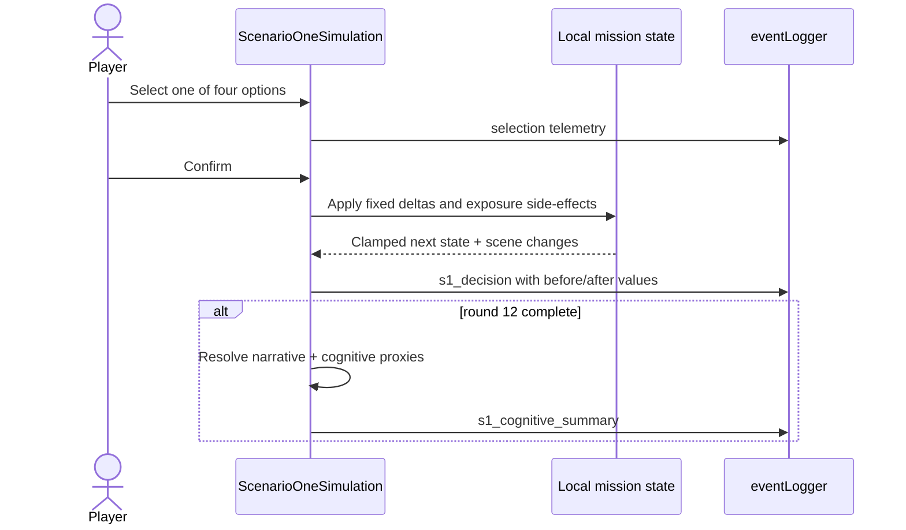
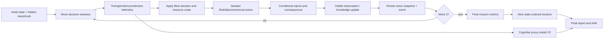

# Decision engine — جریان پردازش تصمیم و داوری

خلاصه فارسی: داوری تصمیم‌ها مبتنی بر قواعد صریح و انتقال حالت است. S4 و S5 علاوه بر قواعد، از مولد شبه‌تصادفی seed‌شده استفاده می‌کنند؛ بنابراین با حفظ seed، نسخه مدل و توالی تصمیم‌ها قابل بازتولیدند. هیچ حریف مبتنی بر هوش مصنوعی یادگیرنده در کد وجود ندارد.

## Executive finding

There is no single universal runtime decision engine. The repository contains a generic `ScenarioEngine`, but the application executes decisions through `ScenarioRunner` and five bespoke simulator components. S4 and S5 have the strongest separation between UI, pure model, adjudicator, and metrics; S1–S3 combine these concerns inside React components.

توضیح فارسی: «موتور تصمیم» در نسخه فعلی یک سامانه واحد نیست. هر سناریو مسیر پردازش خاص خود را دارد؛ در سناریوهای بازطراحی‌شده، منطق تصمیم از رابط کاربری جدا‌تر و قابل آزمون‌تر است.

## Generic tree processing

`ScenarioDefinition` supports `info`, `decision`, `quiz`, `allocation`, `event`, `minigame`, and `end` node types (`src/core/types/scenario.ts:3-98`). In the active UI:

1. `ScenarioRunner` initializes `currentNodeId` to `scenario.start` and resets when the scenario changes (`ScenarioRunner.tsx:35-54`).
2. Node entry starts a monotonic timer and logs `node_enter` (`:64-88`).
3. `goTo(nextId)` changes the node directly after checking that the node exists (`:90-100`).
4. Quiz/decision selection logs an `option_select`; confirmation logs `option_confirm` or a decision event and follows `option.next`/node `next` (`:102-180,360-476`).
5. A minigame delegates to `MiniGameHost`; completion follows the wrapper node's next link (`:534-545`).

The separate `ScenarioEngine` can enter nodes, choose options, allocate, complete minigames, and record assessment events (`src/core/engine/scenarioEngine.ts:21-119`), but no executed UI import/instantiation was found. It should be described as an unused abstraction, not the production orchestrator.

## S0 decision flow

S0 follows the declared learning path (`learningContent.getLearningPath`, `src/ui/components/scenario/scenario-zero/learningContent.ts:3-14`). Info stages require progression/read gates; quizzes select then confirm a coded correct answer (`ScenarioZeroLearning.tsx:100-153,160-231`). The concept lab calculates result records from static option metadata; no world state or opponent response exists (`MiniGameHost.tsx:85-415,470-609,827-888`). All outcomes are deterministic for the same answer sequence.

## S1 legacy flow

State transition is additive and clamped (`applyStatusDelta`, `ScenarioOneSimulation.tsx:738-755`). Information exposure applies action-specific increments/decrements and maps final exposure to `major >= 80`, `limited >= 60`, otherwise none (`:226-280`). Threshold injects occur once at 45, 60, and 75 (`:322-355`). Scene changes are deterministic: `makeOption` derives a stable scene-progress value from option text/ID (`:506-563`). Round 5 alone has a time-based branch: after 45 seconds it confirms `r5_deterrent_maneuver` (`:1288-1313`). This makes human runs timing-dependent even though there is no random draw.

## S2 legacy flow

The player confirms one main action plus up to two support actions. Affordability caps support selection and rejects costs beyond current ISR/energy/time (`ScenarioTwoSimulation.tsx:893-930`). The engine:

1. clones resources/status/convoys/zones/routes;
2. subtracts action costs and applies declared status/convoy effects;
3. executes round/action-specific side effects (`:1120-1255`);
4. recomputes `criticalDelivery`, `logisticsContinuity`, and `navigationIntegrity` (`:838-866`);
5. records before/after decision state (`:1440-1519`);
6. after round 8 calculates mission/cognitive proxies and resolves one of four outcomes (`:1273-1411,1553-1570`).

No `Math.random`/seed path is used; identical legal selections from the same initial state are reproducible.

## S3 flow

Movement cost depends on tile type: shortcut `{time:+4, exposure:+8}`, safe cover `{time:+7, exposure:-3}`, otherwise `{time:+6, exposure:+2}` (`ScenarioThreeDungeon.tsx:398-409`). Intel tiles add confidence and reveal adjacent tiles; fixed threat/noise tiles create a three-option challenge (`:417-430,219-260`). Cards and scans apply fixed deltas (`:435-479`); abilities modify challenge/reveal behavior (`:481-509`). All resources use a clamp helper (`:341-347`). The map, challenges, and effects are static, so the run is reproducible from the action path. There is no autonomous opponent.

## S4 redesigned decision-processing pipeline

### Initial and hidden state

`createInitialScenarioOneState` creates visible/resources/knowledge/hidden partitions and clamps numeric domains (`scenario-four/model/initialState.ts:36-108`). Hidden red intent is selected from weighted values 30/25/20/15/10 (`:20-34`; `adjudication/seededRandom.ts:29-41`). Hidden truth is not exposed in the player projection until AAR.

### Randomness and seeding

S4 implements a string hash plus seeded PRNG/weighted selection in `seededRandom.ts:4-56`. The component creates/reuses a `runId`/`seedBase`, then builds an adjudication seed from `scenarioId`, `userProfileId`, and `runId` (`ScenarioFourRedesignedScenarioOne.tsx:1290-1329`). Actor score tie/noise uses that deterministic RNG (for example Move 3 at `move3Adjudicator.ts:282-321`). Thus a fixed seed and identical decisions reproduce model outcomes.

Limitation: the run key is stored and reused; the hidden intent is derived from `seedBase`, while the adjudication RNG string uses scenario/user/run identifiers. Both are deterministic, but they are separate seed derivations (`ScenarioFourRedesignedScenarioOne.tsx:1290-1329`). Reproducibility requires retaining all identifiers, model versions, and choice records—not merely the visible end state.

### State transitions and conditional events

Move 1 applies blue choice deltas/costs, creates visible observation, evaluates inject conditions, and resolves actor consequences (`scenario-four/adjudication/adjudicator.ts:35-342`). Equivalent functions exist for moves 2 and 3. User resource costs are recorded separately from endogenous recovery/incident deltas (`model/types.ts:180-193`). Move 3 chooses a red action from scored candidates, applies actor/coalition effects, computes final metrics, then runs ordered ending conditions (`move3Adjudicator.ts:282-431,441-498`). Because the ending resolver returns on the first satisfied condition, order is part of adjudication semantics.

### Hidden information and updating

Player attribution estimates are captured at three checkpoints and compared to system evidence confidence; opened/available evidence and dwell time are retained (`model/types.ts:137-176`; `ScenarioFourRedesignedScenarioOne.tsx:1426-1500`). The final AAR deliberately exposes opponent-visible versus hidden material through `buildOpponentObservationAAR` (`model/aarV3.ts:15-84`).

## S5 redesigned decision-processing pipeline

### Run/world assignment

`createRunAssignment` hashes `userProfileId|epoch|s5-v3`; modulo 16 selects one canonical world and the hash supplies a numeric seed (`scenario-five/ui/runAssignment.ts:4-35`). The world factory deterministically derives background anomaly and evidence latency from that seed (`model/worldFactory.ts:19-51`; `model/seededRng.ts:7-32`). Same profile plus same epoch reproduces the assignment; a normal new start time creates a new world/seed.

### Runtime state machine

`createScenario5Runtime` initializes the mission, stage, event sequence, decision/belief/reason/evidence telemetry, and domain records (`model/runtime/runtimeEngine.ts:107-133`). Each decision proceeds through selection, evidence open/close, commit and confirmation (`:148-382`). Beliefs and reasons are submitted only at stage-specific gates (`:384-432`); `continueOutcome` advances from the review stage (`:434-457`). The exact 24-occurrence order is declared in `stageMachine.ts:37-44`.

### Mission step

For each confirmed action, `stepMission`:

1. validates round/action/target and affordability;
2. advances the clock by base 20 minutes plus action duration;
3. subtracts ISR/support and applies action flags/delay;
4. exposes visible behavior to the actor;
5. schedules immediate or pending evidence;
6. obtains deterministic actor response;
7. applies actor delay/integrity/PNT impact and player mitigation;
8. materializes due evidence and updates attribution/convoy statuses;
9. records a domain decision trace and finalizes after round 8.

Evidence is in `model/mission/missionEngine.ts:207-428`; action effects are `:92-131`, operational-impact bases/mitigation are `:133-181`, actor rules are `model/actorModel.ts:14-133`, and evidence materialization/provenance is `model/evidenceModel.ts:21-137`.

Operational actor impact starts from low `(delay 4, PNT 6, integrity 0)`, medium `(8,12,3)`, or high `(14,20,7)` and is progressively scaled by 0.25 in round 1, 0.5 in round 2, and 1 thereafter. Fallback, route hardening, ground support, escort, and temporary protection multiply impacts by fixed factors (`missionEngine.ts:133-181`). Secondary-corridor impact is multiplied by 0.6. Final values are rounded.

### Hidden information

True primary corridor, actor profile/objective/mode, decoy mapping, evidence provenance, and actor internals reside in `trueWorldState`; player views are built through projections (`model/types.ts`; `model/projections.ts`; `ui/presentation.ts:29-78`). Hidden truth becomes available in the AAR (`ui/presentation.ts:249-318`).

### End-state adjudication

`resolveMissionEndState` uses an ordered six-state taxonomy and mission thresholds (`model/mission/endStateResolver.ts:11-111`). This is deterministic and not a learned model. The repository's “nine reachable endings” claim belongs to S4, not S5.

## Reproducibility matrix

| Scenario | Randomness | Seed | Same path reproducible? | Caveat |
|---|---|---|---|---|
| S0 | None | N/A | Yes | timing analytics differ |
| S1 | No PRNG | N/A | Yes, except timeout behavior | round-5 wall-clock auto-choice |
| S2 | None | N/A | Yes | UI legality/selection order must match |
| S3 | None | N/A | Yes | timing analytics differ |
| S4 | Seeded actor/tie behavior | string hash/run identifiers | Yes with complete seed + choices + versions | stored run-key behavior and timestamp-derived run creation must be retained |
| S5 | Seeded world/background/latency | profile + epoch hash | Yes with assignment seed/world + decisions + versions | new wall-clock epoch normally selects a different run |

## Claims not supported by the engine

- No AI/ML opponent, reinforcement learning, large-language-model adjudicator, or networked red team exists.
- No generic rollback/branching UI or persisted in-progress replay exists for all scenarios.
- Deterministic enumeration demonstrates reachability under coded rules; it does not validate real-world probabilities, educational efficacy, or human decision quality.
