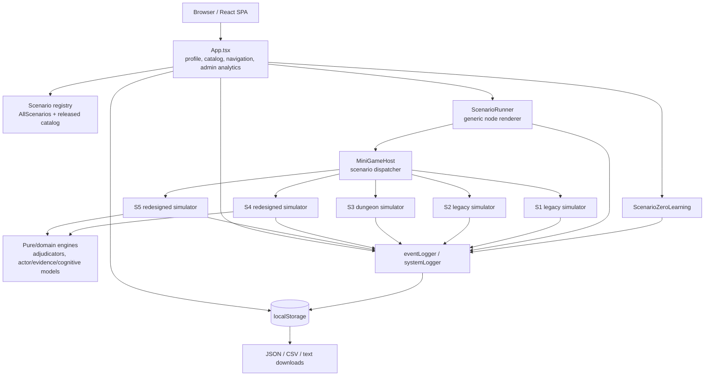
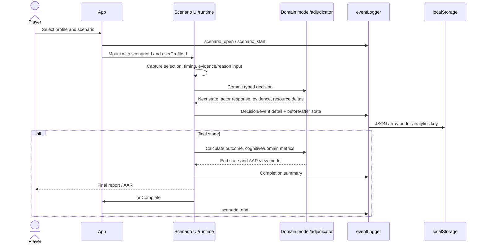

# System architecture — معماری واقعی سامانه

## Scope and evidence status

This document describes the repository as inspected on 2026-11-03. `Implemented` means an executable code path exists; `scaffold` means a type/file exists but no working path was found; `archived evidence` means a generated artifact exists but was not regenerated in this audit. No backend, network API, database, authentication service, or server-side analytics implementation was found.

توضیح فارسی: معماری موجود یک برنامه تک‌صفحه‌ای مرورگرمحور است. تمام اجرای سناریو، داوری، تحلیل و ذخیره‌سازی در سمت کاربر انجام می‌شود؛ بنابراین داده‌ها به‌طور پیش‌فرض فقط در همان مرورگر باقی می‌مانند.

## Technology stack

| Layer | Actual implementation | Evidence |
|---|---|---|
| UI/runtime | React 19.1.1 + React DOM 19.1.1, functional components and hooks | `package.json:29-31`; `src/main.tsx:1-7` |
| Language/build | TypeScript 5.8.x, Vite 7.1.x, React Vite plugin | `package.json:33-47`; build command `tsc -b && vite build`, `package.json:8` |
| Styling/assets | Plain CSS imported per component; static PNG/audio assets | `src/App.tsx:2`; `src/ui/components/scenario/ScenarioFiveSimulation.tsx`; `src/ui/components/common/BackgroundMusic.tsx:60` |
| State management | Local React `useState`/`useRef`/`useMemo`; no Redux/Zustand/context store | examples: `ScenarioRunner`, `src/ui/components/scenario/ScenarioRunner.tsx:35-54`; Scenario 5 runtime state, `src/ui/components/scenario/ScenarioFiveSimulation.tsx:143-161` |
| Persistence | Browser `localStorage`; export/download as JSON, CSV or text | `eventLogger`, `src/services/analytics/eventLogger.ts:42-60,137-168`; backup service, `src/services/storage/systemStorage.ts:19-33,77-132` |
| Quality tooling | ESLint 9, TypeScript compiler, bespoke Node/TS validation scripts | `package.json:6-27,33-47`; `scripts/` |
| External runtime dependencies | React and React DOM only | `package.json:29-32` |

## Executed application architecture

Routing is numeric in `App` and symbolic in the scenario registry: IDs `0..5` map to `s0_...` through `s5_...` (`src/App.tsx:183-190`). `AllScenarios` registers all six definitions (`src/scenarios/index.ts:3-25`). The player-facing released catalog contains only numeric IDs `[0,4,5]`; full-catalog profiles see all six (`src/App.tsx:303-336`). Scenario 0 bypasses the generic runner and uses `ScenarioZeroLearning`; the others use `ScenarioRunner` (`src/App.tsx:2481-2500,2582-2599`). `MiniGameHost` dispatches five bespoke simulators by `game` identifier (`src/ui/components/scenario/MiniGameHost.tsx:613-670`).

## Module responsibilities

| Module | Responsibility and status | Evidence |
|---|---|---|
| `src/App.tsx` | Application shell, profile selection, released/full catalog, progress unlocking, scenario lifecycle events, admin analytics | catalog `201-336`; lifecycle `1020-1136`; analytics `1293-1500` |
| `src/scenarios/*/tree.ts` | Declarative scenario wrapper nodes. S0 contains the full lesson/quiz tree; S1–S5 wrappers mainly launch a minigame then end | S0 `src/scenarios/s0_gateway_space_wargaming/tree.ts:4-517`; S4 wrapper `src/scenarios/s4_redesigned_scenario_one/tree.ts:3-22` |
| `ScenarioRunner` | Renders `info`, `quiz`, `decision`, `allocation`, `event`, `minigame`, and `end` nodes; performs direct node transitions and logging | `src/ui/components/scenario/ScenarioRunner.tsx:35-100,102-180,309-476` |
| `ScenarioZeroLearning` | Guided lesson sequence, required reading, quizzes, concept lab, telemetry | `src/ui/components/scenario/scenario-zero/ScenarioZeroLearning.tsx:100-160,160-231` |
| S1/S2/S3 components | Self-contained legacy simulations with local React state and embedded adjudication | `ScenarioOneSimulation.tsx`, `ScenarioTwoSimulation.tsx`, `ScenarioThreeDungeon.tsx` |
| S4 model | Three-move crisis state, seeded actor behavior, adjudication, hidden truth, cognitive proxy model, final metrics/AAR | `src/ui/components/scenario/scenario-four/model/types.ts:18-378`; `.../adjudication/`; `.../model/cognitiveEngineV3.ts` |
| S5 model/runtime | 16 hidden worlds, 33-action mission model, actor/evidence models, stage machine, cognitive/domain metrics, AAR projection | `.../scenario-five/model/worldCatalog.ts:9-72`; `.../model/mission/actionCatalog.ts:30-71`; `.../model/runtime/runtimeEngine.ts:107-457` |
| analytics services | Append-only-in-memory event array mirrored to localStorage; merging/export; separate system audit log | `src/services/analytics/eventLogger.ts:42-172`; `systemLogger.ts:3-24`; `logExport.ts:18-67` |
| storage services | Profiles and whole-system backup/restore/reset for selected keys | `profileStorage.ts:9-107`; `systemStorage.ts:19-132` |

## Runtime data flow

For S4 and S5, the adjudicators receive explicit typed inputs and return new state/snapshots. S4 persists per-move/final snapshots; S5 keeps runtime state in the mounted component and emits selected summaries to the global event log. Details and limitations are in `decision-engine.md` and `decision-trace-and-aar.md`.

## State management and persistence

1. **Ephemeral UI/domain state — implemented.** Components use local React state. Examples: S3 resources/position/cards at `ScenarioThreeDungeon.tsx:287-300`; S4 run state around `ScenarioFourRedesignedScenarioOne.tsx:1290-1375`; S5 runtime state at `ScenarioFiveSimulation.tsx:143-161`.
2. **Profiles/progress — implemented in localStorage.** Key `space-war.profiles.v1`; load/save at `src/services/storage/profileStorage.ts:9,30-90,105-107`.
3. **Behavior log — implemented in localStorage.** Key `space-war.analytics.events`; enabled flag `space-war.analytics.enabled` (`eventLogger.ts:33-34,42-60,175-188`).
4. **System log — implemented separately.** Key `space-war.system.events` (`systemLogger.ts:3-24`).
5. **S4 snapshots — implemented.** Keys begin `space-war.scenario4.` and are included by backup validation (`systemStorage.ts:89`). The component uses scenario-specific storage/run keys (`ScenarioFourRedesignedScenarioOne.tsx:182-183,1290-1375,1628-1722,1820-2043`).
6. **S5 resumable persistence — not implemented.** The runtime is local component state; completion is logged, but no S5 state key or hydration path was found.
7. **Backup/restore — implemented, browser-local.** Only whitelisted app/profile/behavior/system/S4 entries are accepted (`systemStorage.ts:77-132`).

## Generic engine versus actual execution

`ScenarioEngine` and `AssessmentRecorder` form a generic in-memory engine abstraction (`src/core/engine/scenarioEngine.ts:21-119`; `assessmentRecorder.ts:7-59`). The active UI does not instantiate `ScenarioEngine`; `ScenarioRunner` performs transitions itself (`ScenarioRunner.tsx:35-100`). `AssessmentRecorder` therefore is not the persistent runtime trace for the current application. Files `src/core/engine/scoringEngine.ts`, `timeTracker.ts`, `src/state/gameStore.ts`, `userStore.ts`, `src/services/storage/localStorageAdapter.ts`, and `storageKeys.ts` are empty scaffolds. They must not be described as implemented stores, scoring engines, or adapters.

## Security and deployment limitations

- Admin selection compares a client-side password to literal `"8888"`; this is an interface gate, not secure authentication (`src/services/storage/profileStorage.ts:92-95`).
- UUIDs and timestamps originate in the browser (`crypto.randomUUID`, `Date.now`) and logs have no signature, server receipt, access control, or tamper-evident chain (`eventLogger.ts:63,109-123`; `systemLogger.ts:14-20`).
- `localStorage` capacity, deletion, browser profile, private mode, and manual developer-console editing affect durability and integrity.
- No personal-data retention policy, consent workflow, encryption-at-rest, remote synchronization, or multi-user concurrency layer was found.

## Documentation discrepancies

- Root `README.md:1-68` is the default Vite/React template and does not describe the application, scenarios, persistence, or validation.
- The generic engine/store filenames suggest architecture that is not wired into the executed UI; the actual architecture is component-local plus bespoke scenario engines.
- The code contains six scenarios, but ordinary released profiles see three catalog entries: introductory S0 plus redesigned S4/S5 relabeled as scenarios 1/2 (`src/App.tsx:303-307`). Legacy S1–S3 remain accessible only to full-catalog/admin/tester profiles (`src/App.tsx:316-336,478-483`).
- Backup wording can imply a full application backup, but the implementation only exports selected localStorage entries; S5 in-progress runtime is not among them (`systemStorage.ts:19-33,77-132`).
